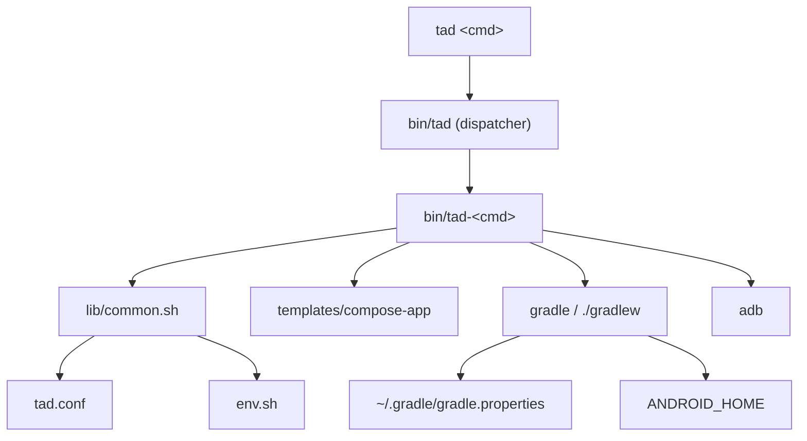

# Architecture

## Purpose

TAD turns a stock, unrooted Android phone running Termux into a complete Android
build environment for Kotlin + Jetpack Compose. It exists because the standard
toolchain assumes an x86-64 desktop host, and several of its pieces cannot run on
an ARM device at all.

The design goal: **the only things that cross the network are Termux packages,
Google's Android SDK, Gradle's official distribution and Maven artifacts.** No
third-party tooling, in any form.

## Constraints

These constraints explain every decision below.

| Constraint | Consequence |
|---|---|
| Host is `aarch64`; `build-tools`/`platform-tools` natives are x86-64 | AGP's default `aapt2` and `adb` cannot execute; both must be replaced |
| Builds run on a phone: ~1.5 GB free RAM, no CI | Gradle daemon and heap must be constrained; builds take minutes |
| One device is both host and target | Testing uses adb over loopback (`127.0.0.1`) |
| No third-party dependencies permitted | Every workaround must use an official knob |
| Installs must be reproducible and relocatable | No absolute paths baked into scripts |

## Component map

| Component | Responsibility |
|---|---|
| `bin/tad` | Dispatcher; resolves the root and `exec`s `bin/tad-<cmd>` |
| `bin/tad-setup` | Installs Termux packages and the Google SDK, writes `env.sh`, configures Gradle |
| `bin/tad-*` | One command each: `doctor`, `new`, `init`, `build`, `compile`, `run`, `install`, `test`, `clean`, `adb` |
| `lib/common.sh` | Path resolution, output helpers, config and env loading, Gradle invocation, APK verification, adb helpers |
| `tad.conf` | The single source of version and path truth |
| `templates/compose-app` | Compose project template, rendered by token substitution |
| `install.sh` | Clone-or-pull, then hands off to `tad-setup` |
| `.agents/skills/tad` | Agent Skill that teaches coding agents to drive the CLI |

## Control flow

**Setup.** `tad setup` installs the Termux packages, downloads Google's
command-line tools, accepts the licences, installs the platform and build-tools,
points `platform-tools/adb` at Termux's adb, then writes `env.sh` and the global
Gradle properties. Every step is idempotent, so an interrupted run can simply be
repeated.

**Project creation.** `tad new` copies `templates/compose-app`, substitutes
tokens (`PKG`, SDK levels, plugin versions), writes `local.properties`, and
generates the Gradle wrapper *in a throwaway directory* so the project is never
configured just to write four files.

**Build.** `tad compile` runs only `compileDebugKotlin` (or the chosen variant)
for a faster typecheck with no packaging. `tad build` runs Gradle and then
verifies the resulting APK. Verification is not optional: Gradle can print
`BUILD SUCCESSFUL` while emitting an APK with no manifest or resource table.

**Run and test.** `tad run` builds, installs with `--user 0`, resolves the
launcher activity and starts it. `tad test instrumented` delegates to Gradle's
`connectedDebugAndroidTest`, which shells out to `platform-tools/adb`.

## Design decisions

| # | Decision | Rationale |
|---|---|---|
| 1 | Native Termux, no proot | Avoids syscall-emulation overhead; proot existed to paper over missing packages, which Termux now ships |
| 2 | Only Termux packages and Google's SDK | Reproducible and auditable — nothing to trust beyond two official sources |
| 3 | `android.aapt2FromMavenOverride` → Termux aarch64 `aapt2` | The SDK's `aapt2` is x86-64. Verified against every AGP 9 resource task, including `optimizeReleaseResources` under R8 and resource shrinking, so no compatibility shim is required |
| 4 | SDK native directories kept off `PATH` | Prevents x86-64 `adb`/`aapt2` from shadowing the working Termux copies |
| 5 | `platform-tools/adb` symlinked to Termux's adb | AGP's on-device tests invoke that exact path |
| 6 | No `org.jetbrains.kotlin.android` plugin | AGP 9 has built-in Kotlin and rejects the plugin |
| 7 | Kotlin pinned to AGP's bundled KGP | The Compose compiler plugin must match the KGP version exactly |
| 8 | `compileSdk` set via the minor-API DSL (`37.2`) | Current AndroidX requires consumers to compile against API 37 or later |
| 9 | APK verification in `tad build` | Guards against the false-success mode described above |
| 10 | Prefer Termux's Gradle over `./gradlew` | Avoids re-downloading a ~150 MB distribution when an equivalent Gradle is installed; `TAD_GRADLE` overrides |
| 11 | Gradle daemon off, heap capped | The daemon is unreliable under on-device memory pressure |
| 12 | `TAD_ROOT` derived from the script path, never inherited | A stale exported value silently breaks a relocated install |
| 13 | Install to `~/.local/share/TAD`, link commands into `~/.local/bin` | Follows XDG conventions and keeps one `PATH` entry |
| 14 | Phantom-process killer documented, not disabled automatically | Disabling it can drain the battery, so it stays an explicit user action |

## Invariants

Breaking any of these produces confusing, hard-to-diagnose failures.

1. `KOTLIN_VERSION` equals the KGP version AGP bundles.
2. `COMPILE_SDK` + `COMPILE_SDK_MINOR` identify an installed platform.
3. `$PREFIX/bin` precedes every SDK directory on `PATH`.
4. `TAD_ROOT` is computed from the script's own location.
5. `~/.gradle/gradle.properties` contains the aapt2 override.
6. Generated projects never apply `org.jetbrains.kotlin.android`.

## Extension points

| Goal | How |
|---|---|
| Add a command | Create `bin/tad-<name>`; the dispatcher and help pick it up automatically |
| Change versions | Edit `tad.conf`, then re-run `tad setup` (SDK levels) or `tad init` (projects) |
| Use the Gradle wrapper instead of system Gradle | `TAD_GRADLE=wrapper` |
| Install elsewhere | `TAD_INSTALL_DIR=/path ./install.sh` |
| Install from a fork | `TAD_REPO=<url> ./install.sh` |

## Version matrix

Values live in [`tad.conf`](tad.conf); this records what they were verified
against.

| Layer | Version |
|---|---|
| Termux | `openjdk-21` 21.0.12, `gradle` 9.8.1, `kotlin` 2.4.21, `aapt2` 16.0.0.4 |
| Android SDK | cmdline-tools 14742923, build-tools 36.0.0, platform android-37.2 |
| Build | AGP 9.4.1, Gradle 9.8.1, Kotlin 2.2.10, Compose BOM 2026.09.00 |

Verified on a TECNO KL5 (`arm64-v8a`, Android 14 / SDK 34): debug and minified
release APKs, JVM unit tests, and Compose UI instrumented tests on the device.
